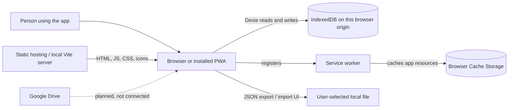
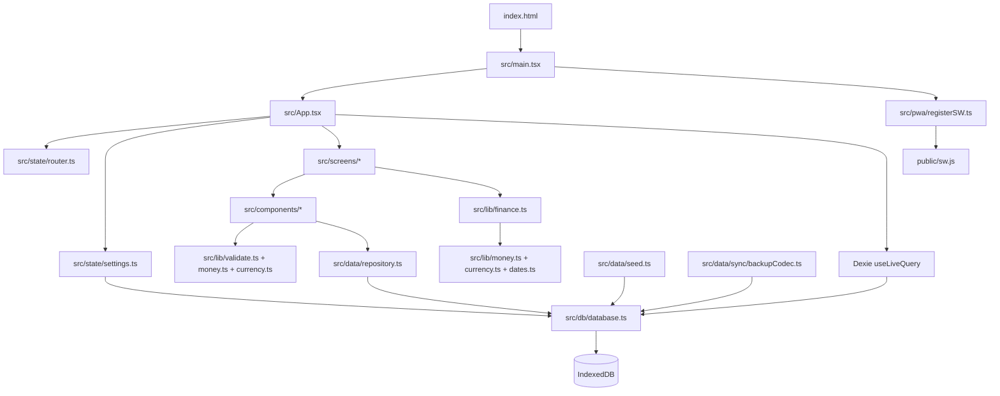
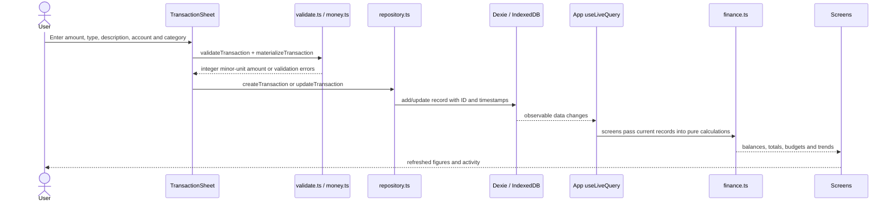

# 03 · System architecture

[← Documentation index](README.md)

This page moves from the big picture to individual modules. It describes the existing Vite/React implementation—not the older Next.js/PostgreSQL prototype and not the future Google Drive integration.

## Level 1: system context



**Meaning:** the person opens the application in a browser or as a home-screen PWA. A static server supplies the code. Financial data is stored in that browser's IndexedDB. The service worker caches application resources separately; it is not the financial database. A JSON file can be exported, although the current importer has a known defect. Google Drive is a future destination only.

## Level 2: runtime pieces

| Piece | Runs where | Responsibility |
| --- | --- | --- |
| Vite dev server | Developer's computer | Serves source modules and refreshes changes during development |
| `dist/` | Static host or local disk | Built HTML, JavaScript, CSS, fonts and icons |
| `server.mjs` | Optional Node process | Serves `dist/` and answers `/api/health`; it does not store ledger data |
| React SPA | Browser | Screens, forms, navigation, calculations and state |
| Dexie / IndexedDB | Browser | Structured local financial records and preferences |
| Service worker / Cache Storage | Browser | Caches selected shell and static-resource responses |
| JSON file | User-chosen location | Exported snapshot; restore needs fixes before it can be relied on |

There is no application server API for transactions, no PostgreSQL in the current app, and no third-party authentication. The optional static server and its health endpoint do not turn it into a database-backed app.

## Level 3: component map



### Entry and screen composition

- `index.html` defines the root element, manifest links and an early theme script.
- `src/main.tsx` mounts `<App />`, loads `src/app.css` and registers the service worker.
- `src/App.tsx` starts demo initialization, subscribes to the main tables using `useLiveQuery`, reads preferences, picks a screen from the current hash route, and passes records down as props. It uses `React.lazy` for most non-Home screens, including the Recharts-based Insights screen.
- `src/components/nav/Nav.tsx` provides the responsive shell. `QuickAdd.tsx` provides the floating transaction entry point.
- `src/screens/*` compose UI components and call calculation or mutation functions. `src/components/ui/*` supplies cards, buttons, sheets, dialogs, feedback and other reusable controls.

### Important boundary: what the code does today

`src/data/repository.ts` contains most CRUD and data-access functions, but it is **not yet the only module accessing Dexie**. `App.tsx`, `src/state/settings.ts`, `src/components/nav/QuickAdd.tsx`, `src/data/seed.ts`, and `src/data/sync/backupCodec.ts` also use `db` directly. Some older source comments describe a stricter intended boundary than the implementation currently enforces.

Likewise, `listTransactions()` currently loads records into an array and filters in memory. Indexes are defined, but the code does not consistently use them for every list. Refactoring these reads behind a repository is a future improvement, not a prerequisite to understanding the current data flow.

## Level 4: a transaction from tap to screen



For a foreign-currency income or expense, `TransactionSheet` also collects a manual reporting rate and calls `convertMinor`; the record can carry both the original amount and a `baseAmountMinor`. A transfer does not receive such a conversion. See the multi-currency warnings in [Data model and finance](04-data-model-and-finance.md).

## Navigation and state

`src/state/router.ts` is a small **hash router**. Changing the part of the URL after `#` does not require a server route for every screen:

| Hash | Screen |
| --- | --- |
| `#/` or no hash | Home |
| `#/activity` | Activity |
| `#/budgets` | Budgets |
| `#/goals` | Goals list |
| `#/goal/<id>` | Goal detail |
| `#/insights` | Insights |
| `#/accounts` | Accounts list |
| `#/account/<id>` | Account detail |
| `#/settings` | Settings |

The router recognizes `categories`, but `App.tsx` has no corresponding screen case, so it falls back to Home. Component state such as open sheets and filters is held in React `useState`; derived totals are often memoized with `useMemo`. There is no separate global state library.

Theme, reporting currency, enabled currencies and the hide-amounts preference use `src/state/settings.ts`. That module currently writes IndexedDB directly. Theme is also mirrored to `localStorage` as `pocket-ledger-theme` so `index.html` can apply a theme before React starts. The general exchange-rate Settings fields are not wired to the `useExchangeRates` hook in `App.tsx`.

## Folder map

```text
index.html                   Entry HTML, PWA metadata and early theme selection
src/main.tsx                 React mount, stylesheet, service-worker registration
src/App.tsx                  Data subscriptions and screen composition
src/app.css                  Semantic design tokens, themes, type and motion
src/screens/                 Home, Activity, Budgets, Goals, Insights, Accounts, Settings
src/components/              Reusable UI, navigation, transaction sheets, money display
src/design/                  Icon registry and Lucide icon sizing/weight helpers
src/state/                   Hash router and preference hooks
src/db/schema.ts             TypeScript record shapes
src/db/database.ts           Dexie database name, stores and indexes
src/data/repository.ts       Most record operations and some live-query hooks
src/data/seed.ts             Sample categories, accounts, records and reset logic
src/data/sync/               Backup codec, adapter interfaces and sync manager
src/lib/                     Finance, money, currency, dates, validation and IDs
public/                      PWA manifest, service worker and application icons
scripts/                     Git bundle export utility
vite.config.ts               Vite plugins, alias and development settings
server.mjs                   Optional static production server
```

## Architecture boundaries and future work

The intended long-term separation is UI → repository → local database, with cloud backup behind a `SyncAdapter`. The current prototype does not fully enforce that boundary, and its Drive adapter is a stub. Do not treat the existence of an interface or a UI label as proof of a complete integration. See [Storage, backup and sync](05-storage-backup-and-sync.md) and [Known issues](08-known-issues-and-roadmap.md).
