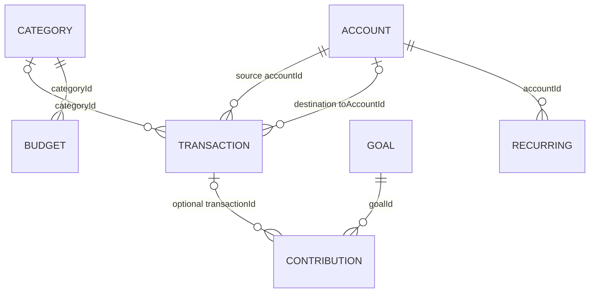

# 04 · Data model and finance

[← Documentation index](README.md)

The record types live in `src/db/schema.ts`; the IndexedDB stores and indexes are declared in `src/db/database.ts`. Dexie names the browser database **`pocket-ledger`**, currently at schema version **1**.

> This is a description of the present implementation, not a guarantee of accounting correctness. See the mixed-currency and backup warnings below before using real data.

## How the records relate



These are application-level IDs, not SQL foreign keys. IndexedDB does not automatically enforce the relationships. A deleted or malformed referenced record can leave an orphan; validation and deletion policies must be checked in the relevant repository function.

## Stores and key fields

| Store | Key | What is saved | Important indexes / links |
| --- | --- | --- | --- |
| `accounts` | `id` | Name, type, currency, opening balance, description, archived flag, order, timestamps, revision | `currency`, `type`, `archived`; transactions reference `accountId` |
| `categories` | `id` | Name, Lucide icon name, hue, income/expense kind, custom/system flags, timestamps, revision | `kind`, `name`, compound `[kind+name]` |
| `transactions` | `id` | Type, positive `amountMinor`, currency, source account, optional destination/category, description, date, notes and optional conversion | `date`, `type`, account/category/currency, `[accountId+date]`, `[categoryId+date]` |
| `budgets` | `id` | Category, currency, amount, start/end month, timestamps and revision | `categoryId`, `startsOn`, `[categoryId+startsOn]` |
| `goals` | `id` | Name, target, currency, optional date/description, icon/hue, archived flag and revision | `currency`, `archived`, `targetDate` |
| `goalContributions` | `id` | Signed amount, goal, currency, date, note and optional transaction link | `goalId`, `transactionId`, `[goalId+date]` |
| `recurring` | `id` | Label, type, amount, account, category, expected date and active flag | `nextDate`, `active`, `accountId` |
| `preferences` | `key` | Reporting currency, enabled currencies, theme, privacy and demo settings | Key/value records—not `id` records |
| `syncMetadata` | `key` | Local metadata such as export or restore timestamps | Key/value records—not `id` records |

Most records include `createdAt`, `updatedAt` and numeric `revision`. New IDs use table prefixes such as `acc_`, `txn_`, `bud_`, `goal_` and `gco_` with UUIDs. The sample data uses recognizable `_demo_` IDs. IndexedDB's primary key rejects duplicate `add` operations, but some import/update paths use `bulkPut`, so callers must still validate records and collision behavior.

The recurring store has repository functions and demo examples; the current app does **not** expose a full recurring-schedule editor or automatically post due transactions.

## Money representation

`src/lib/money.ts` represents a stored amount as an integer `Minor`, a JavaScript number containing the smallest unit configured for that currency. `src/lib/currency.ts` controls the precision and formatting.

| Input | Configured precision | Stored `amountMinor` |
| --- | ---: | ---: |
| UGX 50,000 | 0 | `50000` |
| USD 12.34 | 2 | `1234` |
| KES 10.50 | 2 | `1050` |

The current catalog configures UGX, RWF, TZS and JPY with zero decimal places and USD, KES, EUR, GBP, ZAR and NGN with two. This documents the **application's configuration**, not a certification that every entry matches current ISO 4217 or a provider's settlement rules; verify the catalog against authoritative currency requirements before production.

`parseAmountToMinor` removes grouping characters and converts text into digits. It truncates extra fractional digits; transaction validation rejects missing/non-positive amounts. Some forms sanitize input before validation. Results are JavaScript numbers, so arithmetic must remain within the safe-integer range. Exchange rates and percentage calculations still use floating-point numbers and rounding; they need more boundary tests for financial-grade assurance.

## Dates and timestamps

- Transaction and contribution dates are strings such as `2026-11-07`. `src/lib/dates.ts` groups months with `YYYY-MM` derived from the date string.
- Creation and update metadata use ISO timestamps from `new Date().toISOString()`.
- `todayISO()` formats the user's local date. Some other code, including Home's upcoming-item filter, uses `new Date().toISOString().slice(0, 10)`, which is UTC-based; these can disagree near a timezone boundary.

The app uses `date-fns` helpers for parsing, formatting and calendar arithmetic. Invalid-date behavior should be tested explicitly before accepting untrusted imports.

## Account balances

`accountBalance(account, transactions)` in `src/lib/finance.ts` starts with `openingBalanceMinor` and walks the transaction list:

```text
balance = opening balance
        + income assigned to the account
        - expenses assigned to the account
        - transfers sent from the account
        + transfers received by the account
```

Ordinary income/expense entries are ignored if their currency differs from the account's currency. Transfers are handled before that currency check: **the same raw integer is applied to both accounts**, even if the currencies differ. Cross-currency transfers are therefore unsafe in this version; the UI does not currently prevent them.

For the Home available balance, `totalInCurrency` sums only accounts whose currency matches the selected reporting currency. The Accounts screen groups totals by account currency.

## Monthly income, spending and net

`monthlyTotals()` selects the requested `YYYY-MM`, skips transfers, and includes each remaining transaction only when `reportableMinor()` can produce an amount in the reporting currency:

1. Use the stored `baseAmountMinor` when `baseCurrency` matches the report currency.
2. Otherwise use the original amount if its currency already matches.
3. Otherwise exclude the record and increment `skippedForeignCount`.

```text
net = included income − included expense
```

Changing the reporting currency does not automatically recompute historic conversions. A transaction's saved conversion belongs to the `baseCurrency` stored with it. Some other UI aggregates do **not** use `reportableMinor`; the protections above should not be assumed to cover the whole app.

## Budgets

`budgetPerformance()` finds active budgets by `startsOn`/`endsOn`, selects matching-category expenses for a month, and compares the reporting amounts with the stored cap:

```text
remaining = budget amount − spent
used percentage = spent ÷ budget amount × 100
```

Status thresholds are `<60%` OK, `≥60%` watch, `≥85%` near and `≥100%` over. A UI progress bar is visually capped at 100%, but the numeric percentage can exceed it. The implementation does not ensure that each budget's currency matches the reporting currency before comparing or summing it. Updating a cap edits the existing budget record rather than creating a new historical version.

## Goals and contributions

`goalProgress()` sums signed `goalContributions.amountMinor` for one goal. A positive value adds to the goal, and a negative value withdraws. The visual progress is capped at 100%; the underlying sum can be higher. An optional target date is used to suggest a per-month amount based on whole calendar-month differences.

When an account is selected, `contributeToGoal()` creates a linked **expense** for a contribution or **income** for a withdrawal, together with the contribution in one IndexedDB transaction. This classification affects income/spending reports; it is not a transfer. The current code does not prevent a withdrawal larger than the recorded goal total.

The Goals overview sums raw `savedMinor` and `targetAmountMinor` across goals and labels the result using the first goal's currency. That is incorrect if goals use different currencies. Treat combined goal totals as single-currency only until corrected.

## Practical limitations

- Activity's per-day net and some suggested-budget totals sum raw amounts without grouping by currency.
- Budget totals, cross-currency transfers and combined goals require currency-aware guards or conversions.
- `revision` is based on local wall-clock time, not a distributed conflict-resolution clock.
- There is no enforced database-level foreign key, no deletion tombstones, and no complete historical budget versions.
- The existing test suite covers useful pure calculations, but it does not establish that every UI, import, or mixed-currency case is safe.

See [Known issues and roadmap](08-known-issues-and-roadmap.md) for the recommended fixes and the exact source files.
